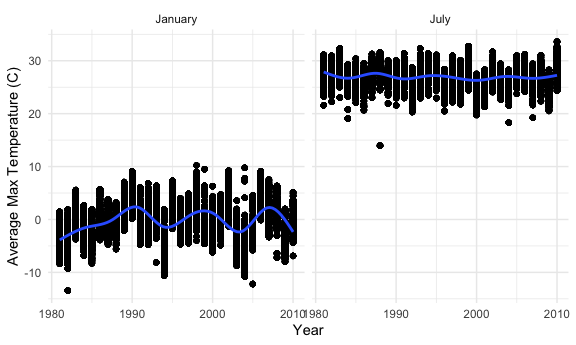
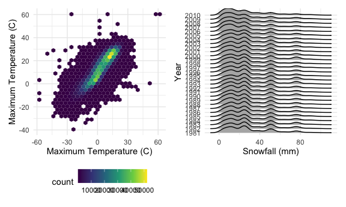
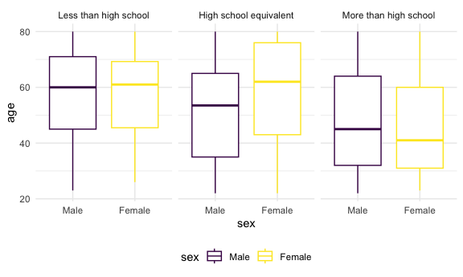
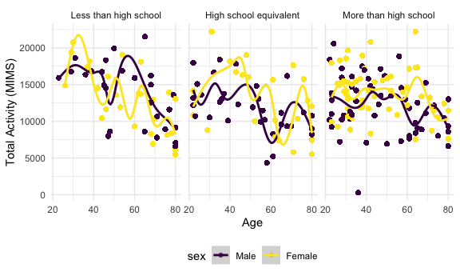
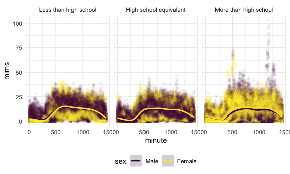
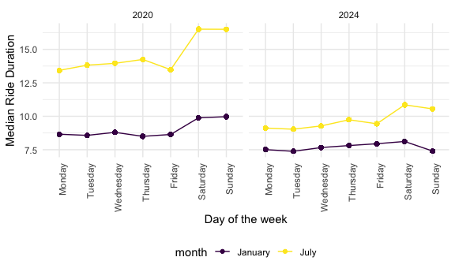
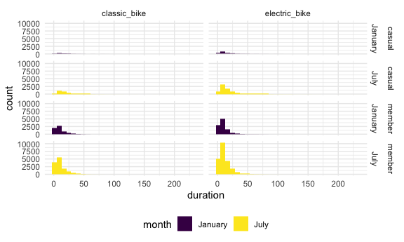

p8105_hw3_asb2338
================
Alexa Burko
2026-10-13

## Section 0: Libraries and preferences

``` r
library(tidyverse)
library(p8105.datasets)
library(patchwork)
library(ggridges)

knitr::opts_chunk$set(
  fig.width = 6,
  fig.asp = .6,
  out.width = "90%"
)

theme_set(theme_minimal() + theme(legend.position = "bottom"))

options(
  ggplot2.continuous.colour = "viridis",
  ggplot2.continuous.fill = "viridis"
)

scale_colour_discrete = scale_colour_viridis_d
scale_fill_discrete = scale_fill_viridis_d
```

# Problem 1

``` r
data("ny_noaa")
```

The data set has 2595176 observations and 7 variables. This data set
contains the following variables: id, date, prcp, snow, snwd, tmax,
tmin.

The average precipitation in the data set is 29.82 tenths of mm, the
average snowfall in the data set is 4.99 mm, and the average snow depth
in the data set is 37.31 mm.

Missing data is a big issue in this data set. The ID variable and the
date variable both have 0 and 0 missing observations. However, the rest
of the variables all have missing data.

prcp has 145838 missing observations, snow has 381221 missing
observations, snwd has 591786 missing observations, tmax has 1134358
missing observations, and tmin has 1134420 missing observations

## Data cleaning

``` r
  noaa_df =
    ny_noaa |> 
  separate(col = date, into = c("year", "month", "day"), sep = "-") |> 
  mutate(across(c(year:tmin), as.numeric)) |> 
  mutate(
    prcp = prcp / 10,
    tmax = tmax / 10,
    tmin = tmin / 10
  )
```

I converted the precipitation variable from tenths of mm to mm and I
conveted tmax and tmin from tenths of degrees celcius to degrees celcius

``` r
noaa_df |> 
  count(snow) |> 
  arrange(desc(n))
```

    ## # A tibble: 282 × 2
    ##     snow       n
    ##    <dbl>   <int>
    ##  1     0 2008508
    ##  2    NA  381221
    ##  3    25   31022
    ##  4    13   23095
    ##  5    51   18274
    ##  6    76   10173
    ##  7     8    9962
    ##  8     5    9748
    ##  9    38    9197
    ## 10     3    8790
    ## # ℹ 272 more rows

The most commonly observed values for snowfall are 0 mm, 25 mm, and 13
mm. It makes sense that the most commonly observed value for snowfall is
0 mm because it does not snow at all most days.

``` r
noaa_df |> 
  filter(month %in% c(1,7)) |> 
  mutate(
    month = case_match(
      month,
      1 ~ "January",
      7 ~ "July"
    )
  ) |> 
  group_by(id, year, month) |> 
  mutate(avg_tmax = mean(tmax, na.rm=TRUE)) |> 
  ggplot(aes(x=year, y = avg_tmax))+
  geom_point()+
  geom_smooth()+
  facet_grid(.~month)+
  labs(
    x = "Year",
    y = "Average Max Temperature (C)"
  )
```


The temperature is lower and more variable in January than in July.
There seems to be at least one outlier in July. Some of the other points
may be considered outliers, though we would need to do further analyses
to confirm this.

``` r
plot_temp = noaa_df |> 
  ggplot(aes(x = tmin, y = tmax))+
  geom_hex() +  
  labs(
    x = "Maximum Temperature (C)",
    y = "Maximum Temperature (C)"
  )

plot_snow = noaa_df |> 
  filter(snow > 0, snow < 100) |> 
  ggplot(aes(x = snow, y = factor(year)))+
  geom_density_ridges() +  
  labs(
    x = "Snowfall (mm)",
    y = "Year"
  )

plot_temp + plot_snow
```



# Problem 2

## Load, tidy, and merge data sets

``` r
demo_df =
  read_csv("data/nhanes_covar.csv", skip = 4, na = c("", "NA", ".")) |>
  janitor::clean_names() |>
  mutate(
    sex = case_match(
      sex,
      1 ~ "Male",
      2  ~ "Female"
    ),
      education = case_match(
      education,
      1 ~ "Less than high school",
      2 ~ "High school equivalent",
      3 ~ "More than high school"
    )
    ) |> 
  mutate(education = fct_relevel(education, c("Less than high school", "High school equivalent", "More than high school")),
         sex = fct_relevel(sex, c("Male", "Female"))
         ) |> 
  filter(age > 21) |> 
  drop_na()

accel_df =
  read_csv("data/nhanes_accel.csv", na = c("", "NA", ".")) |>
  janitor::clean_names() |>
  pivot_longer(
    starts_with("min"),
    names_to = "minute",
    names_prefix = "min",
    values_to = "mims"
    ) |> 
  mutate(minute = as.numeric(minute))

nhanes = left_join(demo_df, accel_df, by = "seqn")
```

## Table of number of men and women in each education category

``` r
nhanes |> 
  group_by(sex, education) |> 
  summarise(
    count=n()
  ) |> 
  knitr::kable(digits=2)
```

| sex    | education              | count |
|:-------|:-----------------------|------:|
| Male   | Less than high school  | 38880 |
| Male   | High school equivalent | 48960 |
| Male   | More than high school  | 77760 |
| Female | Less than high school  | 40320 |
| Female | High school equivalent | 33120 |
| Female | More than high school  | 84960 |

## Visualization of age distributions for men and women in each education category

``` r
nhanes |> 
  ggplot(aes(x = sex, y = age, color = sex)) +
  geom_boxplot() +
  facet_grid(.~education) 
```



The education category with the most males and the most females is more
than high school. There are slightly more females in the less than high
school category than males. People with more than a high school
education tend to be younger those with less than high school or high
school equivalent. However, the distributions of the ages for all of the
age categories do overlap.

``` r
nhanes = 
  nhanes |> 
  group_by(seqn) |> 
  mutate(
    total_activity = sum(mims, na.rm = TRUE))

nhanes |> 
  ggplot(aes(x = age, y = total_activity, color = sex))+
  geom_point() +
  geom_smooth() +
  facet_grid(.~education)+
  labs(
    x = "Age",
    y = "Total Activity (MIMS)"
  )
```


The total activity tends to decrease with age within each education
level for both sexes. However, there is a lot of noise within each
education level, but especially within more than high school. Women tend
to have higher total activity within the high school equivalent and more
than high school categories than males.

``` r
nhanes |> 
  ggplot(aes(x = minute, y = mims, color = sex))+
#  geom_point(alpha = .1)+
  geom_smooth() +
  facet_grid(.~education)
```


Total activity tends to increase as the day goes on before decreasing
again. Women tend to have higher total activity than males. For those
with more than high school, the high point of total activity is stable
for longer than that of the other education categories.

# Problem 3

``` r
jan2020_df =
  read_csv("data/citibike/Jan 2020 Citi.csv", na = c("", "NA", ".")) |>
  janitor::clean_names() |>
  mutate(year = 2020,
         month = "January")

july2020_df =
  read_csv("data/citibike/July 2020 Citi.csv", na = c("", "NA", ".")) |>
  janitor::clean_names() |>
  mutate(year = 2020,
         month = "July")

jan2024_df =
  read_csv("data/citibike/Jan 2024 Citi.csv", na = c("", "NA", ".")) |>
  janitor::clean_names() |>
  mutate(year = 2024,
         month = "January")

july2024_df =
  read_csv("data/citibike/July 2024 Citi.csv", na = c("", "NA", ".")) |>
  janitor::clean_names() |>
  mutate(year = 2024,
         month = "July")

citi_bike_df <- bind_rows(jan2020_df, july2020_df, jan2024_df, july2024_df) |> 
  mutate(weekdays = factor(weekdays, levels = c("Monday", "Tuesday", "Wednesday", "Thursday", "Friday", "Saturday", "Sunday"))) 
```

The resulting data set has 99485 observations and 9 variables. This data
set contains the following variables: ride_id, rideable_type, weekdays,
duration, start_station_name, end_station_name, member_casual, year,
month.

## table showing the total number of rides in each combination of year and month separating casual riders and Citi Bike members

``` r
citi_bike_df |> 
  group_by(year, month, member_casual) |> 
  summarize(
    total_rides=n()
  ) |> 
  pivot_wider(
    names_from = member_casual,
    values_from = total_rides
  ) |> 
  knitr::kable(digits=2)
```

| year | month   | casual | member |
|-----:|:--------|-------:|-------:|
| 2020 | January |    984 |  11436 |
| 2020 | July    |   5637 |  15411 |
| 2024 | January |   2108 |  16753 |
| 2024 | July    |  10894 |  36262 |

There are more rides from members than casual riders in January of 2020
and July of 2024, while there are more rides from casual riders than
members in July of 2020 and January of 2024.

## table showing the 5 most popular starting stations for July 2024

``` r
citi_bike_df |> 
  filter(year == 2024,
         month == "July") |> 
  group_by(start_station_name) |> 
  summarize(
    total_rides=n()) |> 
  arrange(desc(total_rides)) |> 
  head(n=5) |> 
  knitr::kable(digits=2)
```

| start_station_name       | total_rides |
|:-------------------------|------------:|
| Pier 61 at Chelsea Piers |         163 |
| University Pl & E 14 St  |         155 |
| W 21 St & 6 Ave          |         152 |
| West St & Chambers St    |         150 |
| W 31 St & 7 Ave          |         146 |

## plots of effects of day of the week, month, and year on median ride duration

``` r
citi_bike_df |> 
  group_by(year, month, weekdays) |> 
  mutate(median_ride = median(duration, na.rm = TRUE)) |> 
  ggplot(aes(x = weekdays, y = median_ride, color = month, group = month))+
  geom_point()+
  geom_line()+
  facet_grid(.~year)+
  labs(
    x = "Day of the week",
    y = "Median Ride Duration"
  ) +
  theme(axis.text.x = element_text(angle=90, hjust=1))
```


In both 2020 and 2024, median ride duration is higher in July than in
January. However, the median ride duration in July of 2020 is much
higher than the median ride duration in July of 2024, and median ride
duration is slightly higher in January of 2020 than in January of 2024.
In 2020, median ride duration sharply increased on Saturdays and Sundays
compared to during the week days. In July of 2024, median ride duration
also rose sharply on Saturdays. However, in January of 2024, median ride
duration only rose slightly on Saturdays before decreasing to a lower
duration than most of the week days on Sundays.

## figure that shows the impact of month, membership status, and bike type on the distribution of ride duration

``` r
citi_bike_df |> 
    filter(year == 2024) |> 
  group_by(month, member_casual, rideable_type) |> 
  ggplot(aes(x = duration, fill = month))+
  geom_histogram() +
  facet_grid(member_casual~month~rideable_type)
```


